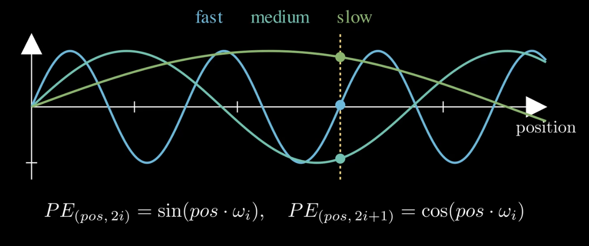

---
class:
  - note
tags:
  - cs/ai/llm/attention
source:
  - https://www.youtube.com/watch?v=EA24K07lH0Y
related:
author:
description:
aliases:
  - RoPE
  - Rotary Position Embedding
date: 2026-05-07T06:24:26-07:00
updated: 2026-11-07T20:42:41-05:00
---

- [[Self Attention]] focuses on seeing relevance of distant tokens to each other, however token ordering is still autoregressive for language; thus **we have to inject position**
	- the most obvious solution is to just number them, first [[Token]] is a `0`, next is a `1`... etc. This *almost works*, but fails in a few ways
		- **grows without bound**, so large position values can drown out the actual meaning in the [[Vectors|vector]]
		- a [[Large Language Model|language model]] trained on short sentences has seldom seen position 5000, so this relies on generalization
		- we want something **bounded**, **unique per position**, and something that understands **relative distance**
	- The original Transformer used something called **sinusoidal encodings**
		- instead of one number, use a bank of sine waves with varying frequencies
		- like a clock with a second/minute/hour hand, they together pin down a unique moment
		- encoding a position is as simple as reading the height of each wave at that position, yielding a unique fingerprint added to the embedding
		- $PE_{(pos, 2i)}=\sin(pos \cdot \omega_{i})$, $PE_{(pos, 2i+1) }=\cos(pos \cdot \omega_{i})$
- [[07-28-2026]] 16:25 - Kimi K3 interestingly decided not to use [[Rotary Position Encoding|RoPE]] and humorously said they use NoPE (No Position Encoding) in their technical paper.

## [[Rotary Position Encoding|RoPE]]

![[Pasted image 20261107204120.png]]

- when computing $k\cdot q$, rotate each pair of components in the query and key by an angle set by its token's position
	- their dot product then depends on **relative position**: the difference between the two rotation angles

$$
RoPE(x_{pos}) = x_{pos} \cdot \cos(\theta_{pos}) + \hat{x}_{pos} \cdot \sin(\theta_{pos})
$$

- for each pair $(a,b)$ in $x$, the corresponding pair in $\hat{x}$ is $(-b,a)$; each pair has its own frequency, with rotation angle $\theta_{pos,i}=pos\cdot\omega_i$
