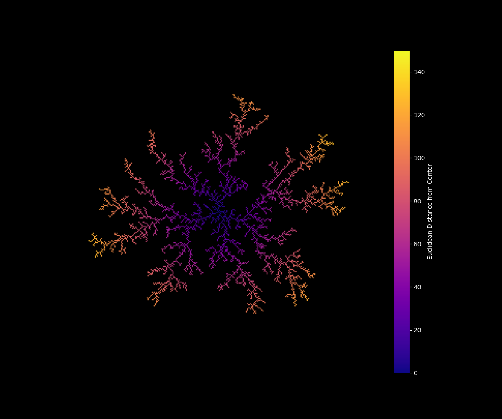

- same thing as a random walk, except we keep releasing more and more walkers onto the lattice
- start with a seed particle in the middle of [[Cellular Automata]] lattice, and then place a particle some distance a part that takes the [[Brownian Motion|brownian]] random walk, until arriving at the seed particle at which point it sprouts into its own seed particle, growing it a little. this continues until the result below
- a [[Dimensionality of Fractals|fractal]] 

