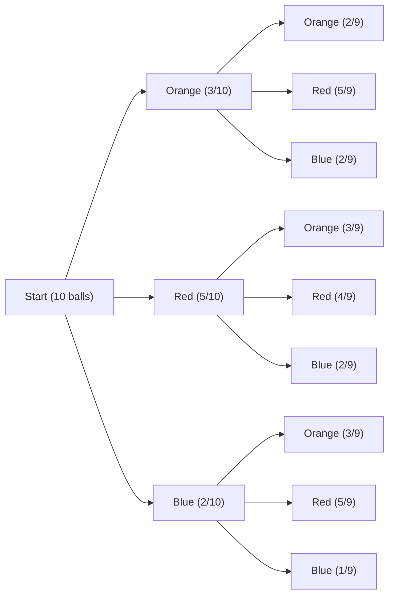

- **conditional probability** $P(A \mid B)$: the probability of [[Notes/Statistics/Event|event]] $A$ once we know $B$ happened; $B$ becomes the new sample space
	$$
	P(A \mid B) = \frac{P(A \cap B)}{P(B)}, \qquad P(B) > 0
	$$
	- rearranged it is the general multiplication rule $P(A \cap B) = P(B)\,P(A \mid B)$ ( [[Probability Rules]] ); flipped it is [[Bayes Rule]]
	- [[Independent Events|independent]] exactly when $P(A \mid B) = P(A)$, and then the intersection is the product $P(A)\,P(B)$
		- two aces with replacement $\frac{4}{52} \cdot \frac{4}{52}$, without replacement $\frac{4}{52} \cdot \frac{3}{51}$
		- independent: roulette spun twice, a coin flipped twice, two dice, sampling with replacement
- example: phones make zero ( $H0$ ), one ( $H1$ ) or more than one ( $H2$ ) handoffs as they move from cell to cell, and calls are long ( $L$, over 3 minutes ) or brief ( $B$ ); 100 calls. Are length and handoffs independent?

|           | H0  | H1  | H2  | Total   |
| --------- | --- | --- | --- | ------- |
| L         | 10  | 10  | 20  | 40      |
| B         | 40  | 10  | 10  | 60      |
| Total     | 50  | 20  | 30  | n = 100 |

- marginals: $P(L) = 0.4$, $P(B) = 0.6$; $P(H0) = 0.5$, $P(H1) = 0.2$, $P(H2) = 0.3$
- conditionals, divide each row by its total: $P(H \mid L)$ and $P(H \mid B)$

| given | H0   | H1   | H2   |
| ----- | ---- | ---- | ---- |
| L     | 0.25 | 0.25 | 0.50 |
| B     | 0.67 | 0.17 | 0.17 |

- or each column: $P(L \mid H0) = 0.2$, $P(L \mid H1) = 0.5$, $P(L \mid H2) = 0.67$
	- conditionals similar to the marginals means no association, independent; different means associated, not independent
	
	- one cell is enough to show it: $P(L \cap H0) = 0.10$ but $P(L)\,P(H0) = 0.4 \cdot 0.5 = 0.20$, so not independent
- tree diagrams: 10 balls in an urn, 3 orange, 5 red, 2 blue, draw two without replacement; each branch is conditional on the one before it

- multiply along a path for a joint probability: $P(O_1 \cap O_2) = \frac{3}{10} \cdot \frac{2}{9} = \frac{1}{15}$
	- add the paths that end in orange for the second draw: $P(O_2) = \frac{3}{10} \cdot \frac{2}{9} + \frac{5}{10} \cdot \frac{3}{9} + \frac{2}{10} \cdot \frac{3}{9} = \frac{27}{90} = 0.3$
	- same as the first draw: the draws are dependent, but each draw on its own still has the original odds
