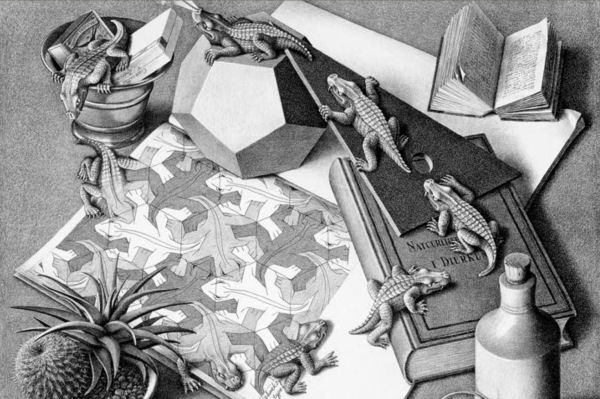

- First encountered this piece reading [[Gödel, Escher, Bach]], on the topic of "jumping in and out of the system". 
- Its called Reptiles, a more celebrated escher work, bringing many of his core ideas together in one piece
	- You can see a more classical escher tesalation piece on the paper at the bottom, with the 3d reptiles jumping in and out of the 2d system.
	- they dont seem to escape the system entirely, in that their journey through 3d space ultimately leads them right back to the 2d sketchbook, completeting the self referential tangled hierarchy.
- [[Holism]] vs [[Reductionism]]
	- While crawling over the desk, the reptiles interact with the dodecahedron and the zoology book, the relationship between a whole and its parts.
	- system that is stricly rule bound but also capable of referring to and interacting wtih itself on multiple levels.

