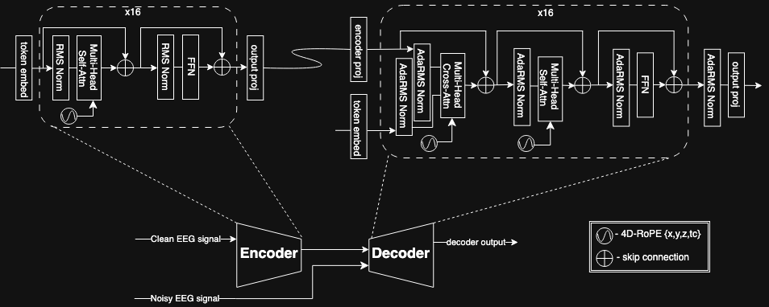

---
source:
  - https://www.zyphra.com/bci
  - https://www.zyphra.com/post/zuna
  - https://huggingface.co/Zyphra/ZUNA
  - https://github.com/Zyphra/zuna
image: https://www.google.com/s2/favicons?domain=https://www.zyphra.com/bci&sz=256
class: website
tags:
  - website
  - cs/ai/diffusion
  - cs/ai/variational
related:
date: 2026-02-19T09:53:37-05:00
updated: 2026-10-23T14:45:48-04:00
---

[[Diffusion in Machine Learning|Diffusion]] [[Variational Autoencoder|Autoencoded]] foundation model for reconstructing and enhacing [[Exploring Personal EEG Solutions|EEG]] signals. Thinking about using in combination with the [[BrainAccess HALO]] EEG headset I have been looking at. A big issue for autistic hobbyist like myself is affordable EEG hardware, this kind of denoising model would be a lifesaver.

--- 

A generative model for reconstructing and enhancing EEG signals. 380M Parameters Diffusion Autoencoder

Montage-Agnostic Scaling. Works across any EEG channel configuration. Hardware-efficient gains. Improves signal quality and downstream performance. Cross-dataset generalization. Generalizes across acquisition systems. Designed for noisy, real-world EEG data.

https://www.zyphra.com/post/zuna
